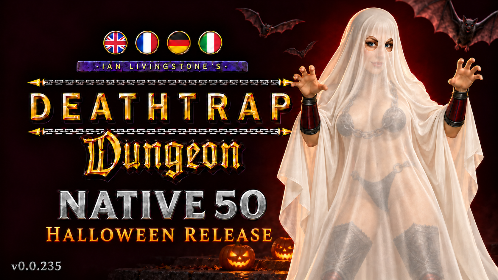

# Deathtrap Native 50 v0.0.235 — Halloween release

[](https://discord.gg/JeMdHz4Np) [](https://ko-fi.com/utkiduck)



Happy Halloween! This release adds an optional E3 1997 heroine reconstruction,
an in-game Native 50 settings book, persistent enemy bodies and a choice of
how to continue after death. It includes all changes since **v0.0.234**.

The complete Windows and Steam Deck experience remains included: approximately
50 FPS presentation without speeding up game logic, widescreen, modern camera
and controls, controller menus, radial selectors and Deck-tuned vibration.

## E3 1997 heroine

A reconstruction based on surviving E3 references, with reworked anatomy,
painted skin details, leather and armor textures, modeled chains and fitted
metal attachments. The front chain has seven links; it and the neck chains
attach separately to the costume. Injury and team variants remain supported.

**This is a reconstruction, rather than a recovered original E3 model file.**
The Halloween sheet is poster artwork, not an additional in-game costume.

### How to enable the new model

1. Install the **complete release ZIP** using the installer below.
2. Open **Setup → Native 50**, then select **Heroine model → E3 1997**.
3. Choose **Red Lotus** to play as the heroine. Model changes save automatically
   and apply immediately, including during a level.

**Original remains selected by default.** Select Original on the same page
to switch back. With the game closed, you can also set `E3Heroine=1` under
`[Models]` in `deathtrap_native.ini`; `0` restores Original.

The model delta is installed automatically. The first launch builds a small
local resource cache using your installed game; later launches validate and
reuse it. `ASYLUM/DUNGEON.BOX` stays untouched. No separate model download,
complete game archive or reference images are included.

## Other changes since v0.0.234

- **Native 50 settings book:** open the animated book in Setup to change modern
  or tank movement, independent camera X/Y inversion, body retention, wound
  visibility and the heroine model. Settings save automatically and support
  keyboard, mouse and controller input in English, French, German and Italian.
- **Optional persistent bodies:** retain fallen enemies' visual models and
  dismemberment while item drops and encounter progression retain their normal
  timing. Off by default; older bodies may be reclaimed to bound memory use.
- **Show wounds:** hide or restore current player injury marks without changing
  health, damage or saves. Wounds remain enabled by default.
- **Continue after death:** choose Load last save or Restart level when a
  successful save or load was recorded in the current level run. Without an
  eligible checkpoint, the level restarts automatically.
- **Attacks in selectors:** ordinary attacks work while keyboard F1–F4 item
  selectors or controller radial selectors are open. Short controller attack
  presses are retained until the next gameplay input tick.
- **Additional rendering capacity:** expanded native render and texture pools
  accommodate the extra model geometry and injury variants.
- **Steam Deck E3 loading:** the model loads and switches correctly under
  Proton/Steam without a false "E3 model is missing" message when its files
  are present.
- **Opt-in diagnostics:** extended logs add graphics and timing information.
  `DebugLog` and `ExtendedLogs` remain **off by default**.

## Installation

Close the game and extract the complete ZIP, keeping the installer and
`payload` directory together. Updating an existing installation uses the same
installer and creates a timestamped rollback copy.

**Windows:** extract beside `DD_CD.EXE` and run `INSTALL.cmd`. Launch normally
through Steam, GOG Galaxy, your shortcut or the executable.

**Steam Deck:** launch the unmodified Steam game once and close it. In Desktop
Mode, open a terminal in the extracted release folder and run:

```sh
bash INSTALL-DECK.sh
```

Return to Gaming Mode and select the standard Steam Input **Gamepad** template.
Launch normally through Steam; no custom Launch Options are required. Normal
Steam libraries, including microSD libraries, are detected automatically.
For a custom game location containing `DD_CD.EXE`:

```sh
bash INSTALL-DECK.sh --game-dir "/path/to/Deathtrap Dungeon"
```

Supported game releases: Steam and GOG English, French, German and Italian.
The included `README.txt` covers custom Proton prefixes and other installation
options. `CHANGELOG.txt` contains the full history; SHA-256 checksums cover
the archive and its individual files.

The download requires a legitimate copy of Deathtrap Dungeon. It includes the
patch, reconstruction delta and required attributed graphics runtimes, without
original game executables, complete game archives or soundtrack.

All downloads and features are free. Optional tips do not unlock downloads,
features, support, rewards or access to future work.

[Full changelog](https://github.com/mbushuev/deathtrap-native-50/blob/v0.0.235/CHANGELOG.md)
· [Changes since v0.0.234](https://github.com/mbushuev/deathtrap-native-50/compare/v0.0.234...v0.0.235)

For bug reports, use Discord and attach the newest `deathtrap-native-*.log`
from the game's `logs` directory.
