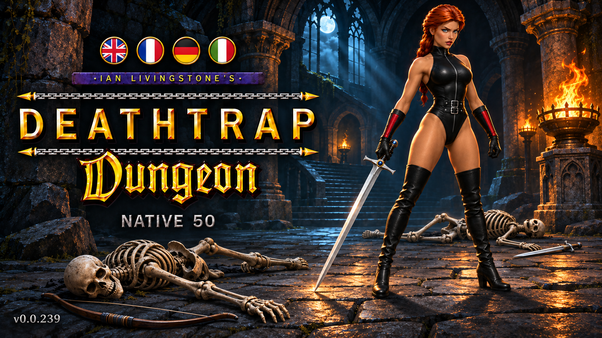

# Deathtrap Native 50 v0.0.239 — Skeleton Deaths

## Changes since v0.0.238

- With **Keep bodies** enabled, regular skeletons and skeleton archers fall at the end of their death animation and stay on the ground. Loot drops and enemy cleanup follow the original game timing.
- Ghosts and skeleton champions complete their original death sequences. The patch also skips body retention when the death animation is missing.

To try it, open **Setup → Native 50** and turn **Keep bodies** on. The option is off by default.

## Install or update

- **Windows (Steam or GOG).** Close the game and run **Deathtrap-Native-50-0.0.239-Setup.exe**. The installer backs up the files it replaces. The ZIP also includes **INSTALL.cmd** for script-based installation.
- **Steam Deck.** Extract the complete ZIP in Desktop Mode, open a terminal in the extracted folder, and run `bash INSTALL-DECK.sh`. Launch through Steam using the standard **Gamepad** layout.
- **Verification.** The SHA-256 file contains checksums for both downloads.

[Report a bug on Discord](https://discord.com/channels/1543231530464321616/1543233906562830418) · [Optional support on Ko-fi](https://ko-fi.com/utkiduck)
