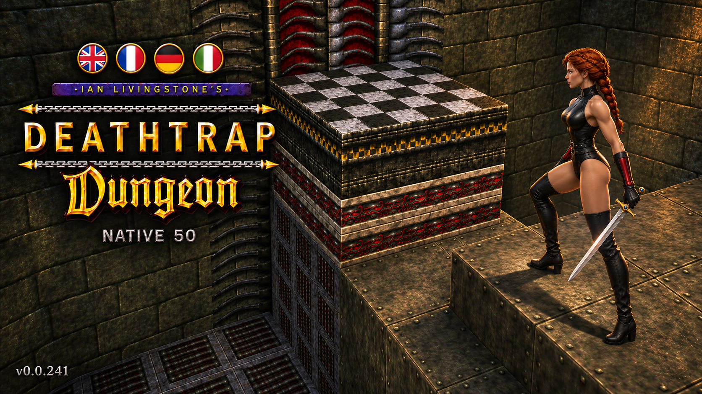

# Deathtrap Native 50 v0.0.241 — World Rendering and Immersive Camera Fixes

The first level's lift now stays behind nearer geometry as the camera turns.
In Inversion, the open door's metal edge stays clear of the bottom of the
skull panel. Texture mapping is corrected across planar room surfaces, even
when part of the surface goes off-screen.

- The immersive first-person camera stays steady during Flame Lance shots and
  recovers after interruptions to the head animation.
- Save thumbnails capture the full scene in widescreen.
- Retained enemy bodies are cleared when a level is restarted or loaded.

## Install or update

- **Windows (Steam or GOG).** Close the game and run
  **Deathtrap-Native-50-0.0.241-Setup.exe**. The installer backs up replaced
  files and preserves existing Native 50 preferences by default. The ZIP
  includes **INSTALL.cmd** for script-based installation.
- **Steam Deck.** Extract the complete ZIP in Desktop Mode and run
  `bash INSTALL-DECK.sh` from the extracted folder. Launch through Steam
  using the standard **Gamepad** layout.
- **Verification.** The SHA-256 file contains checksums for both downloads.

[Report a bug on Discord](https://discord.com/channels/1543231530464321616/1543233906562830418) · [Optional support on Ko-fi](https://ko-fi.com/utkiduck)
