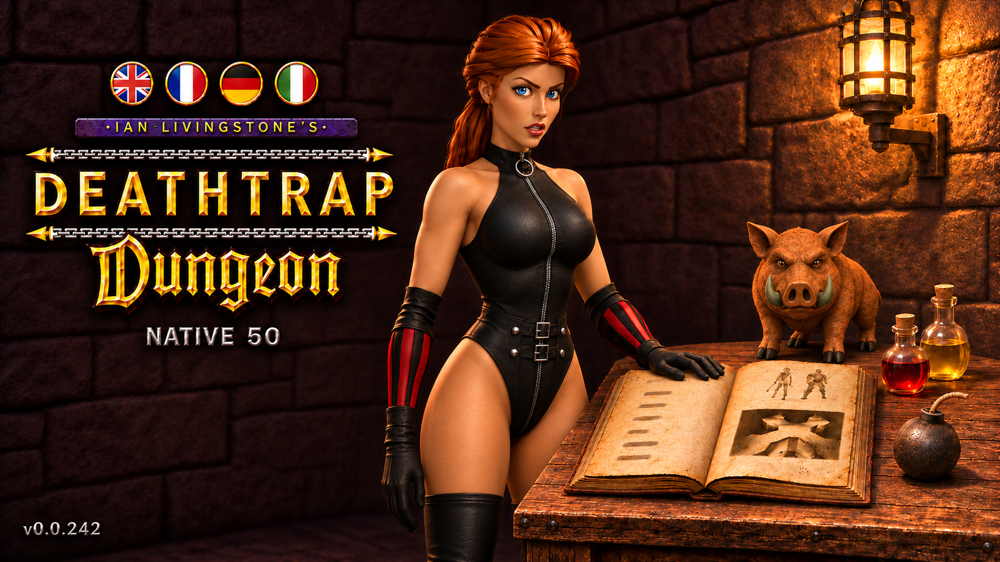

# Deathtrap Native 50 v0.0.242 — Level Loadouts and Ranged Movement

## Level presets

From **New Game**, choose a level and click the loadout line or press **Tab**
to switch between **Original** and **Level preset**. Nine levels, from Circus
through Dragon, have their own starting weapons, ammunition, spells and
consumables. **Spire** always uses the standard starting inventory.
Restarting a level restores the loadout you started with. The selector is
localized in English, French, German and Italian.

Thanks to **DustZero** for proposing level-specific starting loadouts, testing
builds and reporting bugs.

## Ranged movement

With modern controls, you can walk, run and turn while firing ranged weapons
in third person, including the **Flame Lance** and **flamethrower**.

## Install or update

- **Windows (Steam or GOG).** Close the game and run
  **Deathtrap-Native-50-0.0.242-Setup.exe**. The installer backs up replaced
  files and preserves existing Native 50 preferences by default. The ZIP
  includes **INSTALL.cmd** for script-based installation.
- **Steam Deck.** Extract the complete ZIP in Desktop Mode and run
  `bash INSTALL-DECK.sh` from the extracted folder. Launch through Steam
  using the standard **Gamepad** layout.
- **Verification.** The SHA-256 file contains checksums for both downloads.

[Report a bug on Discord](https://discord.com/channels/1543231530464321616/1543233906562830418) · [Optional support on Ko-fi](https://ko-fi.com/utkiduck)
