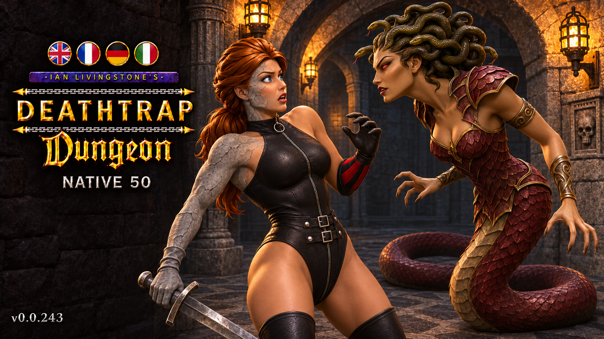

# Deathtrap Native 50 v0.0.243 — Gorgon Petrification and Black-Screen Fixes

## Gorgon petrification

The player's model turns stone gray when petrified. This also works with the
reconstructed E3 Red Lotus model. With modern controls, use the mouse or right
stick to look around the statue before the death menu appears.

## Save loading and display stability

Fixed a video memory leak that could leave the entire game window black after
repeated menu transitions and save loads. Old display and depth buffers are
released, and each save load starts with fresh presentation history.

Repeatedly reloaded the bridge save in **Inversion** and verified that the
flying turtles did not duplicate.

Thanks to **DustZero** for playtesting and reporting these issues.

## Install or update

- **Windows (Steam or GOG).** Close the game and run
  **Deathtrap-Native-50-0.0.243-Setup.exe**. The installer backs up replaced
  files and preserves existing Native 50 preferences by default. The ZIP
  includes **INSTALL.cmd** for script-based installation.
- **Steam Deck.** Extract the complete ZIP in Desktop Mode and run
  `bash INSTALL-DECK.sh` from the extracted folder. Launch through Steam
  using the standard **Gamepad** layout.
- **Verification.** The SHA-256 file contains checksums for both downloads.

[Report a bug on Discord](https://discord.com/channels/1543231530464321616/1543233906562830418) · [Optional support on Ko-fi](https://ko-fi.com/utkiduck)
