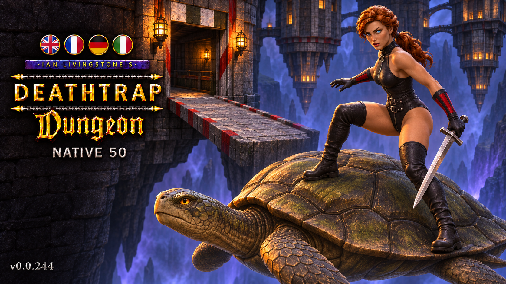

# Deathtrap Native 50 v0.0.244 — Inversion Saves and Camera Fixes

## Flying turtles and save recovery

Reloading a save in **Inversion** now resets the flying turtles and the
triggers that launch them. Saves made on a moving turtle resume with the
platform under the player. This was checked on a fresh launch, through the
load menu, after death, and by making and reloading another save in mid-flight.

Rebuilding a level during a reload restores the inventory from the save,
including keys collected since entering the level.

## Input and camera

- A quick Space tap advances the level briefing, and gameplay input is ready
  when the level opens.
- The third-person camera responds after loading near a wall or obstacle.
- The first-person camera follows the rendered head pose between frames,
  reducing shoulder jitter while blocking. Small movements such as breathing
  are smoother.

Thanks to **DustZero** for reporting the turtle issues and sharing a save we
could use to reproduce them.

## Install or update

- **Windows (Steam or GOG)** — Close the game and run
  **Deathtrap-Native-50-0.0.244-Setup.exe**. The installer backs up replaced
  files and preserves existing Native 50 preferences by default. The ZIP
  includes **INSTALL.cmd** for script-based installation.
- **Steam Deck** — Extract the complete ZIP in Desktop Mode and run
  `bash INSTALL-DECK.sh` from the extracted folder. Launch through Steam
  using the standard **Gamepad** layout.
- **Verification** — The SHA-256 file contains checksums for both downloads.

[Report a bug on Discord](https://discord.com/channels/1543231530464321616/1543233906562830418) · [Optional support on Ko-fi](https://ko-fi.com/utkiduck)
